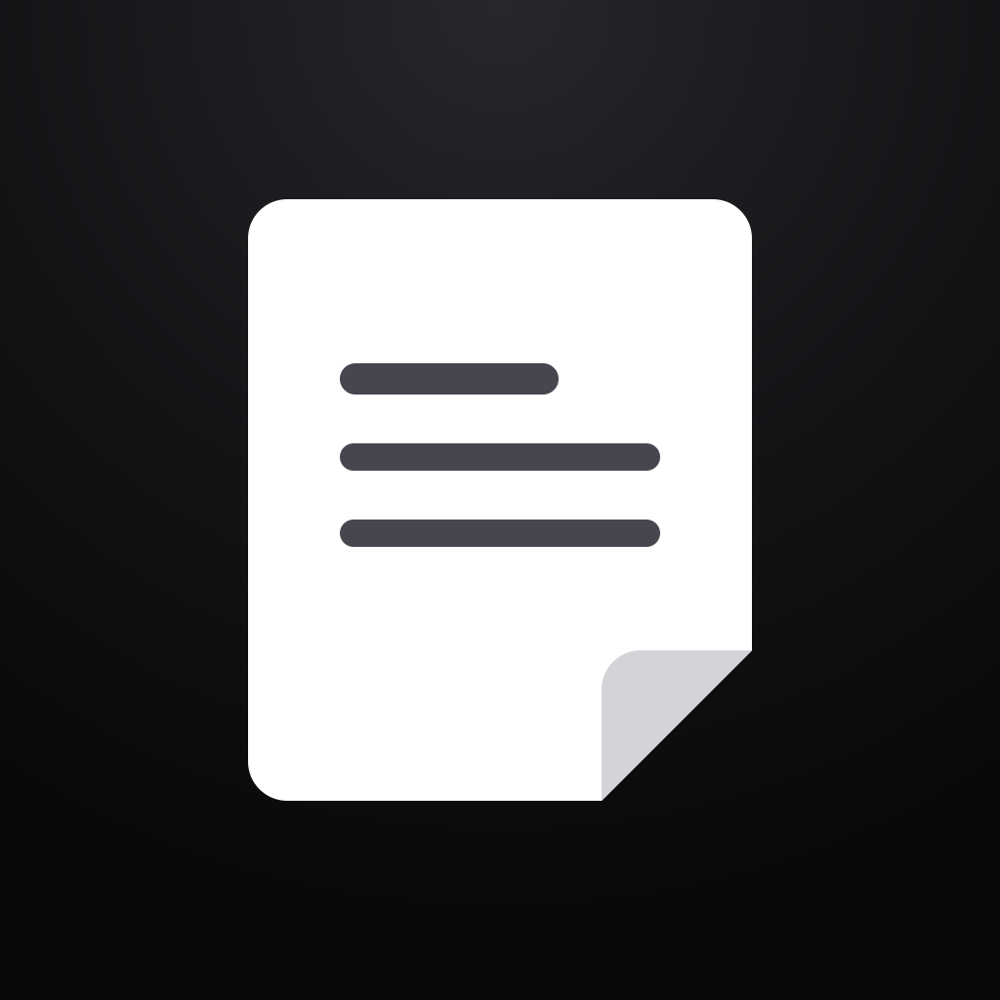

<div align="center">
  
  <h1>Notepad</h1>
  <p>
    <strong>Minimalist multi-platform cloud notes, Word/Excel docs, small-file vault, and 2FA authenticator built strictly for the Cloudflare Free Tier.</strong>
  </p>
  <p>
    <strong>English</strong> · <a href="./README.zh-CN.md">简体中文</a> · <a href="./docs/ARCHITECTURE.md">Architecture Spec</a>
  </p>
  <p>
    <a href="https://note.qqx.qzz.io">Live App</a> ·
    <a href="https://github.com/naka507/Notepad/releases">Releases (Win / macOS / Linux / Android)</a>
  </p>
</div>

---

## Highlights

- **5 Integrated Modules with Independent Categories**:
  - **Notes**: Markdown editor & sanitized preview, pinning, archive, and 30-day trash.
  - **Docs (Word)**: TipTap rich-text editor with client-side `.docx` import & export (body JSON stored in R2, zero D1 bloat).
  - **Sheets (Excel)**: Multi-sheet grid with formula evaluation (`SUM`, `AVERAGE`, `MIN`, `MAX`, `COUNT`, `IF`, `ROUND`, `ABS`) and `.xlsx` / `.csv` import & export.
  - **Files**: Streamed upload (`≤ 5 MiB`) + adaptive multipart upload (`> 5 MiB`), inline Image / PDF / Word / Excel preview, and XSS-safe download headers.
  - **2FA (`TOTP`)**: AES-256-GCM encrypted authenticator vault with live countdown, one-click copy, mobile camera QR scanning (`otpauth://`), local QR image decoding, URI batch import, and manual entry.
- **Shared Design System, Native Per-Platform Layouts**:
  - Swiss monochrome light/dark aesthetic shared across every client, while each platform uses a purpose-built layout:
    - **Web (`apps/web`)**: Centered workspace deployed to Cloudflare Pages with Service Binding.
    - **Desktop (`apps/desktop`, Electron)**: Frameless 3-pane layout, 60px Activity Rail (`Ctrl+1..7`), `Ctrl+K` Command Palette, system tray, OS keychain (`safeStorage`), offline sync cache, and `notepad://` OAuth deep link.
    - **Mobile (`apps/mobile`, Capacitor)**: Single-stack navigation + bottom 5-tab bar, card-style 2FA codes with haptic copy, live camera QR scanner, biometric/PIN app & vault lock, and clean member-consistent settings.
- **RBAC, Quotas & Timed Anonymous Sharing**:
  - First registered / GitHub-authenticated user atomically becomes `admin`; subsequent accounts default to `pending`.
  - Four roles (`pending`, `user`, `member`, `admin`) with real-time downgrade enforcement (historical files are preserved, over-quota items lock immediately and unlock automatically upon upgrade).
  - Timed anonymous share links (`/s/:code`) with optional access password, max view limits, and instant revocation.
- **Cloudflare Free Tier Native**:
  - Runs on Cloudflare Pages + Workers + D1 + R2 (10 GB guardrail) + single-key KV + hourly Cleanup Cron Worker.

## Monorepo Structure

```text
Notepad/
├── apps/
│   ├── web/         # Vue 3 + Vite + Pinia + Element Plus (Cloudflare Pages)
│   ├── desktop/     # Electron 35 desktop app (Windows / macOS / Linux)
│   ├── mobile/      # Capacitor 7 mobile app (Android / iOS)
│   ├── api/         # Cloudflare Workers API (Hono + Zod + D1 + R2 + KV)
│   └── cleanup/     # Hourly Cron Worker (sessions, multipart abort, R2 & trash GC)
├── packages/
│   └── core/        # Shared RBAC, quotas, Zod schemas, TOTP engine, sync & API types
├── assets/          # 1024×1024 master app icon (icon.png / icon.svg)
├── docs/            # Architecture specification & ADRs (docs/ARCHITECTURE.md)
└── .github/
    └── workflows/   # CI verification & multi-platform Release automation
```

## Local Development

### Prerequisites

- Node.js `>= 20` (recommended `22`)
- Cloudflare Wrangler CLI (bundled via workspace devDependencies)
- Optional for native builds: JDK `17` or `21` + Android SDK 35 (for Android APK)

### 1. API & Web

```sh
npm install
cp apps/api/.dev.vars.example apps/api/.dev.vars
npm run db:migrate:local

# Terminal 1 — Local Workers API (http://127.0.0.1:8787)
npm run dev:api

# Terminal 2 — Local Web UI
npm run dev:web
```

- First user to register or sign in via GitHub automatically becomes `admin`.
- Subsequent users default to `pending` until authorized in **Users**.

### 2. Desktop App (Electron)

```sh
# If npm blocks Electron's postinstall script on first install, download the binary once:
node node_modules/electron/install.js

# Start Vite renderer + Electron desktop window
npm run dev:desktop

# Production build & platform installers (NSIS / Portable / DMG / AppImage)
npm run build:desktop
npm run package:desktop
```

### 3. Mobile App (Capacitor Android / iOS)

```sh
# Mobile browser preview (http://127.0.0.1:5181)
npm run dev:mobile

# Build mobile bundle & sync native Capacitor projects
npm run build:mobile
npm run cap:sync

# Open native project in Android Studio / Xcode
npm run cap:open:android -w @notepad/mobile
npm run cap:open:ios -w @notepad/mobile
```

To build a signed Android Release APK locally, create gitignored `apps/mobile/android/keystore.properties` (pointing to your `.jks` file) or set `ANDROID_KEYSTORE_*` environment variables, then run:

```sh
cd apps/mobile/android
./gradlew assembleRelease
```

## Cloudflare Free Tier Deployment

1. Provision Cloudflare resources:
   ```sh
   npm run cf:d1:create
   npm run cf:r2:create
   npm run cf:kv:create
   ```
2. Fill `database_id`, KV `id`, and `APP_URL` in `apps/api/wrangler.toml` and `apps/cleanup/wrangler.toml`.
3. Upload production secrets:
   ```sh
   npm run secret:token:signing
   npm run secret:totp:key
   # Optional for GitHub OAuth:
   npm run secret:github:id
   npm run secret:github:secret
   ```
4. Validate, migrate, and deploy:
   ```sh
   npm run typecheck
   npm run build
   npm run validate:deploy-config
   npm run db:migrate:remote
   npm run deploy:workers
   npm run deploy:web
   ```

> **GitHub OAuth Callback URL**: `https://<your-domain>/api/auth/github/callback`

## Automated CI & Multi-Platform Releases

- **CI (`.github/workflows/ci.yml`)**: Runs `validate:deploy-config`, `typecheck`, and `build` across all 6 workspaces on every push/PR to `main`.
- **Release (`.github/workflows/release.yml`)**: Triggered by pushing a `v*` tag (e.g. `git tag -a v1.0.0 -m "Release v1.0.0" && git push origin v1.0.0`) or via manual dispatch. Builds and attaches:
  - Windows NSIS installer & Portable executable (`.exe`)
  - macOS disk image (`.dmg`)
  - Linux AppImage (`.AppImage`)
  - Android APK (`.apk` — signed Release APK when `ANDROID_KEYSTORE_BASE64`, `ANDROID_KEYSTORE_PASSWORD`, `ANDROID_KEY_ALIAS`, and `ANDROID_KEY_PASSWORD` secrets are configured; otherwise falls back to Debug APK)

## Documentation

- [简体中文说明 (README.zh-CN.md)](./README.zh-CN.md)
- [Architecture Specification & ADRs (docs/ARCHITECTURE.md)](./docs/ARCHITECTURE.md)
