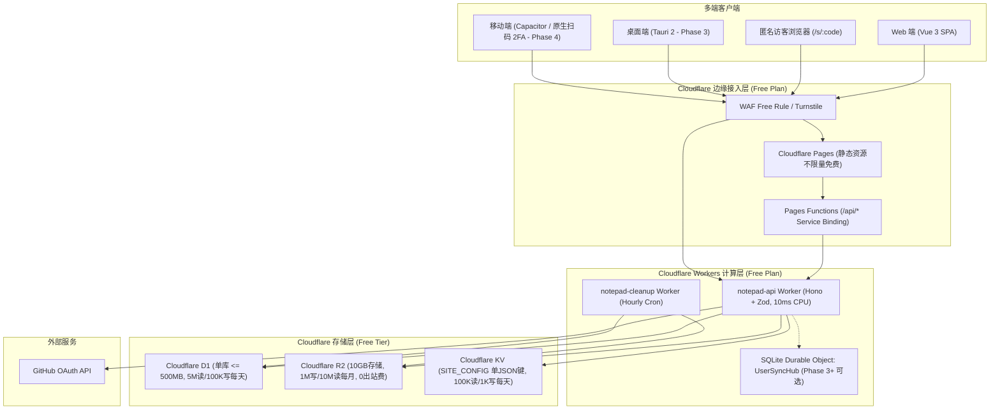
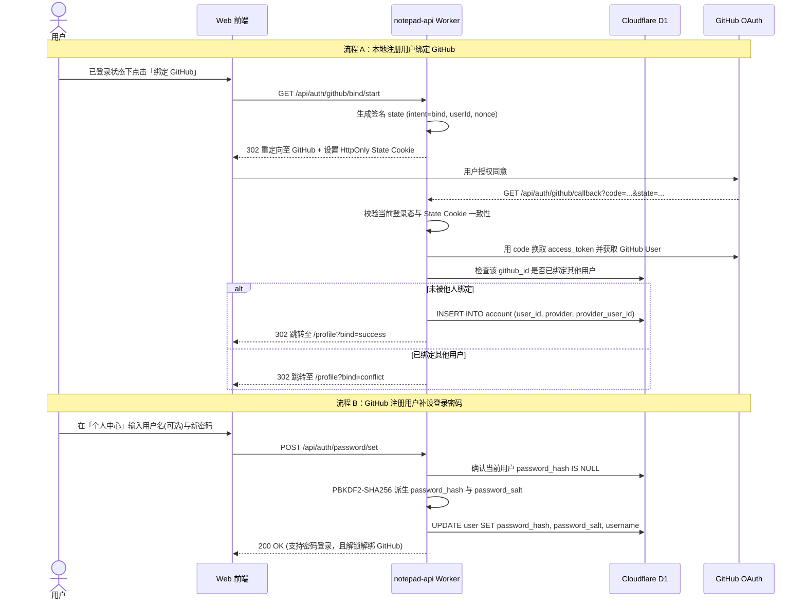
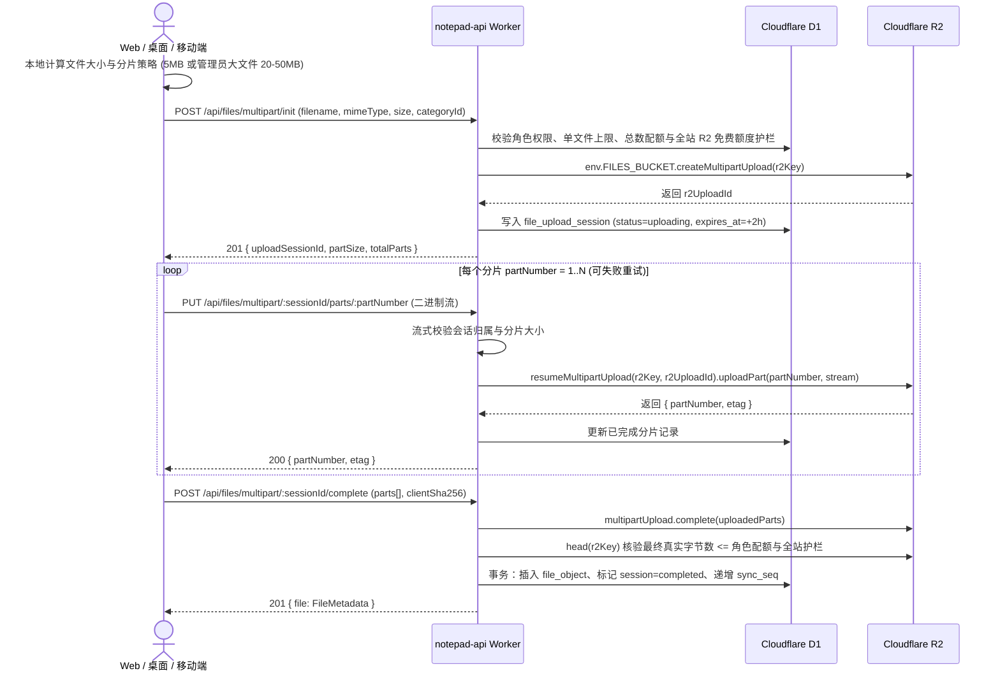
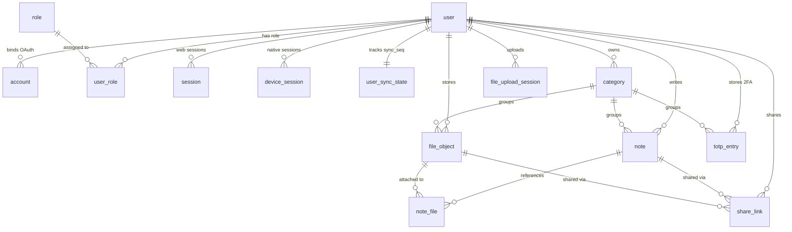

# Cloudflare 备忘录工具（Notepad）系统架构设计文档

> **文档状态**：已定稿 v1.3（含独立在线文档模块：类 Word 富文本 & 轻量在线表格）  
> **目标平台**：Cloudflare 免费额度全栈生态（Pages + Workers + D1 + R2 + KV + Cron Triggers）  
> **参考技术栈**：`mkmail`（Vue 3 + Hono + D1 + KV + npm workspaces Monorepo）

---

## 1. 项目概述与设计目标

### 1.1 产品定位

构建一款**严格运行在 Cloudflare 免费额度（Free Tier）内**的轻量、安全、多端同步个人备忘录与小文件保险箱工具，具备以下核心能力：

1. **记事本**：支持 Markdown 笔记编辑、预览、置顶、归档、回收站与全文搜索。
2. **小文件存储**：基于 Cloudflare R2 提供零出口流量费的个人小文件托管，按角色执行严格的容量与数量配额；管理员不受业务配额限制（仅受 Cloudflare 平台本身限制）。
3. **自定义分类**：支持用户创建自定义分类，统一归类管理记事本、小文件及后续 2FA 条目。
4. **匿名临时分享**：会员用户可将记事本或文件生成匿名分享链接，默认有效期 **1 小时**，允许会员在管理员配置的限定范围内自选有效期；管理员不限有效期。
5. **多端同步**：优先交付 Web 端，架构层预先统一增量同步协议与多端认证机制，平滑演进至桌面端与移动端。
6. **移动端扫码录入 2FA**：面向后续移动端规划内置 TOTP（2FA 验证码管家）模块，支持扫描第三方服务的 `otpauth://` 及迁移二维码录入并加密同步至各端；**本系统自身账号登录暂不引入 2FA**。
7. **灵活账号与强控授权体系**：支持用户名密码注册、GitHub OAuth 登录、双向绑定与补设密码；**首个登录/注册的用户自动成为管理员**；默认用户无任何业务权限；管理员降级角色策略**立即生效**，历史数据与文件保留不删除，但超出当前角色权限范围的内容实时锁定不可访问。

### 1.2 对 `mkmail` 技术栈的继承与演进

| 维度 | `mkmail` 现有方案 | 本项目（Notepad）方案 | 继承 / 演进说明 |
| :--- | :--- | :--- | :--- |
| **工程组织** | npm workspaces Monorepo (`apps/*`, `packages/*`) | 沿用相同 Monorepo 结构，预留 `apps/desktop`、`apps/mobile`、`packages/sync-client` | 直接复用 `tsconfig.base.json` 严格 TS 配置与部署校验脚本 |
| **前端框架** | Vue 3 + Vite + Pinia + Vue Router + Element Plus + `@lucide/vue` + 双语 i18n | 完全沿用，新增 Markdown 编辑器、分片上传组件、匿名分享页 `/s/:code` | 复用既有开发体验、组件体系与 `zh-CN` / `en-US` 自动切换 |
| **边缘接入** | Cloudflare Pages + Pages Functions (`functions/api/[[path]].ts`) Service Binding | 完全沿用同源 `/api/*` 转发，前端 SPA 路由承载 `/s/:code` 匿名落地页 | Web 端零 CORS，天然支持 `HttpOnly` Cookie，静态流量不限量免费 |
| **后端 API** | Cloudflare Workers + Hono + Zod + OpenAPI 3.1 | 完全沿用，按领域拆分为模块化子路由（auth / notes / files / shares / sync / totp / admin） | 严控单次调用 CPU < 10ms（Workers Free 限制） |
| **关系数据库** | Cloudflare D1 (SQLite) + `migrations/*.sql` | 完全沿用，新增笔记、分类、文件元数据、分享、同步游标与 2FA 表 | 严控写放大与单库容量（D1 Free 单库 ≤ 500MB） |
| **对象存储** | 无 | **新增 Cloudflare R2 (`FILES_BUCKET`)** | 支撑 5MB / 50MB / 管理员大文件流式与分片上传，10GB 免费额度 + 零出站费 |
| **键值配置** | Cloudflare KV (`SITE_CONFIG`，每项独立 Key) | **优化为单 JSON Key (`site_config_v1`)** 存入 KV | KV Free 限制 1,000 写/天，合并单 Key 将读写消耗降低 10 倍 |
| **定时任务** | `apps/cleanup` Cron Worker（每小时） | 沿用每小时 Cron (`0 * * * *`)，分批清理过期会话、孤儿分片、待删 R2 对象与回收站 | 占 1 个 Cron Trigger（Free 限 5 个），单批严格控在 50 subrequests 与 10ms CPU 内 |
| **身份与认证** | Session Cookie + API Key；手动点击 `init-emperor` | **升级**：首位用户原子自动成为 `admin`；新增 GitHub 绑定/解绑、补设密码；原生端 Bearer + Refresh Token | 同时满足 Web 同源安全与未来桌面/移动端无 Cookie 场景 |
| **实时同步** | 无 | **Phase 1~2 零 DO 增量游标同步**；Phase 3+ 可选 SQLite-backed Durable Objects（Free Tier 支持） | 初期零额外复杂度，全链路运行于免费额度内 |

---

## 2. 整体系统架构与 Cloudflare 免费额度治理

### 2.1 系统拓扑图



### 2.2 Monorepo 目录结构规划

```text
Notepad/
├── apps/
│   ├── web/                       # Phase 1: Vue 3 + Element Plus Web 端（含匿名分享页）
│   │   ├── functions/api/[[path]].ts   # Pages Function Service Binding -> notepad-api
│   │   ├── public/_redirects           # Pages SPA Fallback: /* /index.html 200
│   │   ├── src/
│   │   │   ├── api/                    # HTTP 客户端与自适应分片上传器
│   │   │   ├── stores/                 # Pinia: auth / workspace / notes / files / sync
│   │   │   ├── views/                  # Login / Pending / Workspace / Shares / Vault2FA / Profile / Admin / PublicShare
│   │   │   └── components/             # MarkdownEditor / CategorySidebar / FileUploader / ShareDialog
│   │   └── wrangler.toml
│   ├── api/                       # Phase 1: Cloudflare Worker API (Hono + Zod)
│   │   ├── src/
│   │   │   ├── index.ts                # 入口与路由挂载
│   │   │   ├── middleware/             # auth / rbac / error
│   │   │   ├── routes/                 # auth / account / categories / notes / files / shares / sync / totp / admin / config
│   │   │   └── lib/                    # db / r2 / crypto / quota / sync / totp / cookies / config
│   │   └── wrangler.toml
│   ├── cleanup/                   # Phase 1: Hourly Cron 定时清理 Worker
│   │   ├── src/index.ts
│   │   └── wrangler.toml
│   ├── desktop/                   # Phase 3: Tauri 2 桌面壳（复用 apps/web 与本地 SQLite）
│   └── mobile/                    # Phase 4: 移动端壳（复用前端 + 原生相机扫码 + 生物识别）
├── packages/
│   ├── core/                      # 共享领域类型、角色权限矩阵、配额策略、Zod Schema、游标编码
│   └── sync-client/               # Phase 2+: 跨端离线存储与增量同步引擎（Web IndexedDB / 原生 SQLite）
├── migrations/
│   └── 0001_initial.sql           # D1 顺序 SQL 迁移文件
├── scripts/
│   └── validate-deploy-config.mjs # 部署前占位符、D1/R2/KV 绑定、APP_URL 校验脚本
├── docs/
│   └── ARCHITECTURE.md            # 本文档
├── package.json
└── tsconfig.base.json
```

### 2.3 Cloudflare 资源清单

| 资源类型 | Binding 名称 | 用途说明 | 关联 Worker / Pages |
| :--- | :--- | :--- | :--- |
| **D1 Database** | `DB` | 用户、OAuth、角色、会话、分类、记事本、文件元数据、分享链接、同步游标、2FA 密文 | `notepad-api`, `notepad-cleanup` |
| **R2 Bucket** | `FILES_BUCKET` | 存储用户上传的小文件（单次流式与分片上传） | `notepad-api`, `notepad-cleanup` |
| **KV Namespace** | `SITE_CONFIG` | 存储合并后的单 JSON 站点配置 `site_config_v1` | `notepad-api` |
| **Service Binding** | `API` | Pages Functions 零公网跳数转发 `/api/*` 至 `notepad-api` | `notepad-web` (Pages) |
| **Worker Secrets** | `GITHUB_CLIENT_ID`, `GITHUB_CLIENT_SECRET`, `TOKEN_SIGNING_SECRET`, `TOTP_ENCRYPTION_KEY` | OAuth 密钥、原生端 JWT/Token 签名密钥、2FA 服务端信封加密主密钥 | `notepad-api` |
| **SQLite Durable Object**（Phase 3+ 可选） | `USER_SYNC_HUB` | 实时多端同步推送（使用 Free Tier 支持的 SQLite 后端 + WebSocket Hibernation） | `notepad-api` |

### 2.4 Cloudflare Free Tier 免费额度约束与工程护栏

所有组件严格按 Cloudflare Free Plan 限额设计，并在代码层内置防超额护栏：

| Cloudflare 产品 | Free Plan 官方额度 | 本架构针对性约束与优化措施 |
| :--- | :--- | :--- |
| **Workers / Pages Functions** | **100,000 请求/天**<br>**10 ms CPU/次**<br>**128 MB 内存**<br>**50 子请求/次** | 1. **绝不在 Worker 内用 JS 缓冲大文件或计算大文件 SHA-256**：上传直通 `ReadableStream` 写入 R2；SHA-256 由客户端用浏览器 `WebCrypto` 计算并传参，≤5MB 单传交由 R2 原生 `put(..., { sha256 })` 校验，几乎零 Worker CPU 消耗。<br>2. **控制子请求数**：单次 API 或清理任务对 R2/D1 的批量操作严格控制在 20 次以内。<br>3. **降低无意义轮询**：前端仅在页面可见时低频（≥60s）探测 `/api/sync/cursor`，切回标签或发生本地变更时立即同步。 |
| **Cloudflare Pages** | 静态请求与带宽**无限免费**<br>500 次构建/月 | Web 静态资源全部由 Pages CDN 直接承接，不消耗 Workers 请求额度。 |
| **Cloudflare D1** | **5,000,000 行读/天**<br>**100,000 行写/天**<br>**500 MB 单库上限**（总 5 GB）<br>50 查询/次 | 1. **禁止将二进制文件/Base64 存入 D1**，全部走 R2，确保 D1 长期处于几十 MB 以内。<br>2. **抑制写放大**：读取类接口禁止每次回写数据库；设备 `last_seen_at` 节流至每 15 分钟最多更新一次；分享 `view_count` 仅在有效查看时累加 1 行。<br>3. `/api/sync/cursor` 精准主键查询仅读 1 行。 |
| **Cloudflare R2** | **10 GB-月 标准存储**<br>**1,000,000 Class A (写)/月**<br>**10,000,000 Class B (读)/月**<br>**$0 出站流量费** | 1. **免费额度全局水位监控与护栏**：因 R2 超出 10GB 后按量计费（$0.015/GB-月），后台实时汇总 `SUM(size)` 展示全站 R2 占用率，并在 `SITE_CONFIG` 中提供全站软预警线（默认 9.0 GB）与可选硬熔断线（默认 9.8 GB，默认开启保护，管理员可调整），防止意外超额产生费用。<br>2. **自适应分片减少 Class A 次数**：5MB~50MB 按 5MB/片；管理员上传 >100MB 超大文件时自动采用 **20MB~50MB/片**（仍低于 Cloudflare Free 单请求 100MB 代理上限），大幅减少请求数与 Class A 消耗。<br>3. 需注意：Cloudflare 控制台开通 R2 时要求账号绑定支付方式，但用量保持在 10GB / 1M Class A / 10M Class B 内完全为 $0。 |
| **Workers KV** | **100,000 读/天**<br>**1,000 写/天**<br>1 GB 存储 | 1. **严禁用 KV 做限流计数或高频会话存储**（1,000 写/天极易耗尽）。<br>2. 将整个站点配置合并为 **1 个 JSON Key (`site_config_v1`)**，每次保存配置仅耗 1 次 KV 写、读取仅耗 1 次 KV 读（并在单个 Worker Isolate 内做 30 秒轻量内存缓存进一步压降读消耗）。 |
| **Cron Triggers** | **最多 5 个/账号**<br>每次 10 ms CPU | 仅使用 **1 个** 每小时触发器 (`0 * * * *`) 驱动 `apps/cleanup`，单批限量删除（`BATCH_SIZE = 20`），若当小时有残留则下一小时继续消化，永不超时。 |
| **WAF & Turnstile** | WAF Free 限流规则<br>Turnstile 免费额度 | 匿名分享防刷与登录保护优先采用 Cloudflare WAF 免费速率限制规则 + Turnstile 人机验证，不消耗 D1/KV 写配额。 |
| **Durable Objects（预留）** | Free Plan 仅支持 **SQLite 后端 DO**（总存储 5 GB，与 Workers 共享 100K 请求/天） | **Phase 1 & Phase 2 完全不引入 DO**；Phase 3+ 如需毫秒级推送，仅采用 Free Tier 支持的 **SQLite-backed DO + WebSocket Hibernation API**，避免任何付费功能依赖。 |

---

## 3. 身份认证与账号体系设计

### 3.1 账号认证能力矩阵

> **边界明确**：本系统自身账号登录**暂不需要 2FA 双因素认证**，保持简洁流畅的「用户名密码 + GitHub OAuth + 可选 Turnstile」登录体验。2FA 能力专门用于第 5.6 节的「内置 TOTP 验证码管家」。

1. **用户名 + 密码注册/登录**
   - 密码加密沿用 `mkmail` 方案：Web Crypto API `PBKDF2-SHA256`（100,000 次迭代 + 16 字节随机盐 + 恒定时间比对 `timingSafeEqualString`），调用原生 C++/BoringSSL 实现，实测仅占 ~2–5ms CPU，安全运行于 Workers Free 10ms 限额内。
   - 支持在站点配置中按需开启 Cloudflare Turnstile 人机校验。
2. **GitHub OAuth 注册/登录**
   - 首次使用 GitHub 登录时自动创建本地 `user`（`password_hash = NULL`）与 `account (provider='github')` 绑定记录，自动生成唯一 `username`（冲突时追加数字后缀）。
3. **已注册用户绑定 / 解绑 GitHub**
   - 已登录用户在「个人中心」发起 `GET /api/auth/github/bind/start`，OAuth state 记录 `intent = "bind"` 及当前 `user_id` 签名绑定关系。
   - 回调阶段验证当前会话用户与 state 一致，并确认该 GitHub `provider_user_id` 未绑定其他用户后写入 `account` 表。
   - **防锁死校验**：解绑 GitHub (`DELETE /api/auth/github/bind`) 前必须检查 `user.password_hash IS NOT NULL`，尚未设置密码时拒绝解绑并提示先补设密码。
4. **GitHub 注册用户补设密码 / 修改密码**
   - **首次补设密码** (`POST /api/auth/password/set`)：当 `user.password_hash IS NULL` 时允许直接设置初始密码，并支持同步修改自动生成的 `username`。
   - **修改已有密码** (`POST /api/auth/password/change`)：需校验旧密码；修改成功后支持一键撤销其他设备的历史会话。
5. **防账户劫持安全策略**
   - **禁止静默按邮箱自动合并账号**：GitHub 回调登录仅通过 `(provider='github', provider_user_id)` 查找既有绑定，不在未登录态仅凭 email 自动合并进既有密码账号；如需合并，由用户密码登录后手动绑定 GitHub。

### 3.2 首位登录用户自动成为管理员（原子化防竞态）

需求要求：**“第一个登录的用户为管理员，默认用户没有任何权限”**。

在 D1 中使用单例主键抢占表 `system_bootstrap`：

```sql
CREATE TABLE IF NOT EXISTS system_bootstrap (
  singleton_key INTEGER PRIMARY KEY CHECK (singleton_key = 1),
  admin_user_id TEXT NOT NULL REFERENCES user(id),
  initialized_at INTEGER NOT NULL
);
```

无论首位用户通过「用户名+密码注册」还是「GitHub 首次登录」进入系统：

1. 插入 `user` 记录。
2. 执行 `INSERT OR IGNORE INTO system_bootstrap (singleton_key, admin_user_id, initialized_at) VALUES (1, ?, ?)`。
3. 检查 SQLite 返回的 `meta.changes`：
   - `changes === 1`：原子抢占成功，直接授予 `admin` 角色。
   - `changes === 0`：管理员已存在，授予默认角色 `pending`（无任何业务权限）。

### 3.3 账号双向绑定与补设密码时序图



### 3.4 多端会话认证架构

| 客户端形态 | 认证载体 | 有效期与刷新策略 | 登出与安全控制 |
| :--- | :--- | :--- | :--- |
| **Web 端** | `HttpOnly` + `SameSite=Lax` + `Secure` Cookie (`notepad_session`) | 30 天，D1 存 `token_hash` | 服务端删除 `session` 行立即失效 |
| **桌面端 / 移动端** | `Authorization: Bearer <access_token>` + `refresh_token` | `access_token` 为 HMAC-SHA256 签名短令牌（15 分钟，无状态校验省 D1 读）；`refresh_token` 30 天且**每次刷新强制轮换** | D1 `device_session` 记录设备信息与 `token_family_id`；检测重放立刻吊销家族；`last_seen_at` 仅在刷新或间隔 >15 分钟时更新以节约 D1 写额度 |

> **关键安全细节**：由于角色降级/禁用必须**立即生效**，即使原生端使用 15 分钟短期 Access Token，每次请求仍只做 1 次极轻量的 D1 主键联查获取当前 `user.disabled_at` 与 `role`（消耗 1 行 D1 读，500 万/天免费额度极其充裕），确保管理员降级或禁用用户在 **0 延迟** 下生效！

---

## 4. RBAC 权限模型与配额治理

### 4.1 角色与权限矩阵

系统预置 4 个互斥主角色：

| 角色 (`role.name`) | 角色说明 | 记事本 & 分类 & 同步 | 单文件大小上限 | 文件总数上限 | 匿名分享 | 2FA 保险箱 | 用户授权 & 站点配置 |
| :--- | :--- | :---: | :---: | :---: | :---: | :---: | :---: |
| `pending` | **默认用户**（新注册默认，无任何权限） | ❌ | ❌ | 0 | ❌ | ❌ | ❌ |
| `user` | **普通用户** | ✅ | **5 MB** (`5,242,880 B`) | **100 个** | ❌ | ✅ | ❌ |
| `member` | **会员用户** | ✅ | **50 MB** (`52,428,800 B`) | **500 个** | ✅ 默认 1 小时，可在限定范围内自选 | ✅ | ❌ |
| `admin` | **管理员**（首位登录自动获得） | ✅ | **无业务限制**（仅受 Cloudflare 平台限制） | **无业务限制**（仅受 Cloudflare R2 免费额度限制） | ✅ 默认 1 小时，有效期无上限（含永久） | ✅ | ✅ |

> **细粒度权限枚举 (`packages/core/src/permissions.ts`)**：
> - `note:manage` — 记事本与分类 CRUD、搜索、多端同步
> - `file:manage` — 文件上传、预览、下载、分类移动、删除
> - `share:manage` — 创建、查看、撤销匿名分享链接
> - `totp:manage` — 2FA 密钥录入、管理、多端同步
> - `user:manage` — 查看用户列表、角色授权、禁用/启用、删除用户
> - `config:manage` — 站点全局配置与免费额度护栏管理
>
> **角色 -> 权限映射**：
> - `pending`: `[]`
> - `user`: `["note:manage", "file:manage", "totp:manage"]`
> - `member`: `["note:manage", "file:manage", "share:manage", "totp:manage"]`
> - `admin`: 全部权限（且配额检查标记 `unlimited: true`）

### 4.2 配额强一致性校验机制

1. **单文件大小双层硬校验**（对 `user` / `member` 强制生效；`admin` 跳过业务大小限制，仅受全站 R2 免费额度护栏检查）：
   - 上传初始化阶段校验 `declared_size <= roleQuota.maxFileSize`。
   - 数据流经 Worker 写入 R2 时，通过轻量 `ByteCountTransformStream` 实时统计真实字节数，一旦超限立刻中断流并 `abort` R2 上传，返回 `413 Payload Too Large`。
2. **文件总数原子配额占位**（对 `user` ≤ 100 / `member` ≤ 500 生效；`admin` 无数额限制）：
   - 活跃文件口径：`file_object (deleted_at IS NULL)` + 活跃未过期的 `file_upload_session (status = 'uploading' AND expires_at > now())`。
   - 初始化上传前执行事务校验，确保并发上传无法突破上限。
3. **全站 R2 Free Tier 护栏**：
   - 当全站已用 R2 总字节 + 当前上传 `declared_size` 超过管理员配置的免费额度硬熔断线（默认 9.8 GB）时，拒绝写入并提示“存储空间已接近 Cloudflare 免费额度上限”，保护账号绝不意外产生计费。

### 4.3 管理员降级与状态变更策略（立即生效、数据保留、权限受控不可访问）

| 管理操作 | 立即生效机制与数据访问控制规范 |
| :--- | :--- |
| **降级为无权限默认用户（`member` / `user` → `pending`）** | 1. **立即生效**：接口鉴权实时读取最新角色，该用户下一次任意请求立即拦截。<br>2. **数据完整保留**：用户名下所有记事本、分类、文件（D1 + R2）及 2FA 条目**全部保留不删除**。<br>3. **完全无法访问**：所有记事本、文件、2FA、同步接口立即返回 `403 Forbidden`，Web 端自动跳转至 `/pending` 受限页（仅保留 `/profile` 账号安全页与退出登录）。<br>4. **既有分享立即失效**：降级同一事务内将用户名下全部未撤销的 `share_link` 设为 `revoked_at = now()`，匿名访客立即可见失效提示。 |
| **会员降级为普通用户（`member` → `user`）** | 1. **立即生效 & 数据完整保留**：该用户此前在会员期上传的全部文件（包括 >5MB 文件及第 101~500 个文件）在 D1 和 R2 中**完整保留不删除**，待日后恢复 `member` 后可即时重新解锁。<br>2. **超额/超大文件严格锁定无法访问**：系统在列表查询、详情读取、下载/预览（`GET /api/files/:id/content`）与同步接口中**实时计算当前角色的可用窗口**：<br>&nbsp;&nbsp;- 规则 A（单文件大小受控）：所有 `size > 5MB` 的历史文件均判定为 `locked`（`lockReason = "file_size_exceeded"`），**无法预览、无法下载、无法读取内容**（API 返回 `403 Forbidden`）。<br>&nbsp;&nbsp;- 规则 B（文件数量受控）：在所有未删除文件中，仅按 `created_at ASC` 排序的前 100 个且 `size <= 5MB` 的文件维持正常可访问；**超出第 100 个配额之外的所有文件均判定为 `locked`（`lockReason = "file_count_exceeded"`），无法预览、无法下载、无法读取内容**。<br>&nbsp;&nbsp;- 禁止新上传：只要当前总文件数 ≥ 100，禁止上传新文件；用户可选择手动删除锁定文件以释放配额，或等待管理员重新授予 `member` 立即解锁全部文件。<br>3. **匿名分享立即撤销失效**：降级同一事务内将用户名下全部未撤销的 `share_link` 批量更新为 `revoked_at = now()`，且公开分享端点同时实时校验创建者是否仍具备 `share:manage` 权限，双重保障外部访客立即无法查看或下载。 |
| **禁用用户 (`disabled_at`)** | 立即清空全部 `session` 与 `device_session` 强制下线；撤销全部活跃分享；数据保留但账号无法登录。 |
| **删除用户** | 将用户名下全部 `file_object.r2_key` 批量写入 `pending_r2_deletion` 表后再级联删除 `user`，由 `ctx.waitUntil` 尝试即时清理并由 `cleanup` Worker 兜底清除 R2 物理文件。 |
| **管理员自身保护** | 不允许管理员修改/降级自身角色、不允许禁用或删除自身，亦不允许降级或删除其他 `admin`。 |

---

## 5. 核心业务领域架构

### 5.1 自定义分类系统

- **统一分类模型**：用户维护自定义分类（`category` 表），统一归类管理「记事本」、「小文件」与「2FA 条目」。
- **核心属性**：`id`、`name`、`icon`、`color`、`parent_id`（预留 2 级嵌套，Web v1 先呈现扁平清晰侧栏）、`sort_order`。
- **安全删除**：删除分类时，其下记事本、小文件及 2FA 条目的 `category_id` 自动置为 `NULL`（归入“未分类”），不删除任何内容。

### 5.2 记事本与独立在线文档模块（Word 富文本 & 轻量表格）

为兼顾“极简秒开速记”与“结构化宽屏文档编辑”，系统将 **记事本（`/workspace`）** 与 **在线文档（`/docs`）** 拆分为独立工作区，同时共享同一套自定义分类、匿名分享（`/s/:code`）、RBAC 权限与增量同步游标：

1. **轻量记事本（Markdown）**
   - 正文采用标准 **Markdown (GFM)** 纯文本存储于 D1，适配三端一致渲染；支持置顶 (`is_pinned`)、归档 (`is_archived`)、30 天回收站 (`deleted_at`)、摘要缓存 (`excerpt`) 与乐观锁版本号 (`version`)。
   - 笔记关联文件通过 `note_file` 表维护引用关系。
2. **独立在线文档（`document` 表 + R2 JSON 存储）**
   - **类 Word 富文本文档 (`doc_type = 'doc'`)**：前端采用 TipTap 编辑器（标题、段落、加粗/斜体/下划线/高亮、列表、任务清单、嵌套表格、对齐、撤销重做），支持纯前端懒加载 `mammoth` 导入 `.docx` 与 `docx` 导出标准 `.docx` 文件。
   - **轻量在线表格 (`doc_type = 'sheet'`)**：内置极简黑白灰风格多 Sheet 电子表格，支持键盘导航、复制粘贴单元格区域、列排序、单元格基础格式与常用公式引擎（`SUM`/`AVERAGE`/`MIN`/`MAX`/`COUNT`/`IF`/`ROUND`/`ABS` 及算术引用），支持懒加载 `xlsx` 导入导出 `.xlsx` / `.csv`。
   - **Cloudflare 免费额度存储分离**：D1 `document` 表仅存轻量元信息与摘要，正文 JSON 统一存 R2（`d/{userId}/{docId}.json`），既不消耗 D1 500MB 单库配额，也不计入用户的“小文件 100 / 500 个配额”（仍受全站 10GB 免费额度护栏保护）。
   - **小文件在线预览联动**：「文件」模块与匿名分享页对已上传的 `.docx` / `.xlsx` / `.csv` 文件同样支持按需懒加载免下载在线预览。

### 5.3 小文件存储与 R2 上传/下载架构

严格围绕 **Workers Free（10ms CPU / 128MB 内存 / 100MB 单请求代理上限）** 与 **R2 Free（10GB 存储 / 1M Class A / 0 出站费）** 设计双通道同源上传方案：

1. **通道一：单次流式直传（文件 ≤ 5 MiB，覆盖普通用户全部文件及小文件）**
   - `POST /api/files/upload`：客户端先在本地计算 `sha256`（浏览器原生 WebCrypto 毫秒完成），通过 Header 传递文件元信息，请求体为原始文件二进制流。
   - Worker 通过 `ReadableStream` + `ByteCountTransformStream` 直接 pipe 给 `env.FILES_BUCKET.put(r2Key, stream, { sha256, httpMetadata })`——由 R2 存储层校验 `sha256` 完整性，Worker 几乎零内存与零 CPU 占用。

2. **通道二：R2 原生自适应分片上传（文件 > 5 MiB，涵盖会员 50MB 及管理员大文件）**
   - 客户端按规则切分分片（满足 R2 非尾片 ≥ 5 MiB 要求且单次 HTTP 请求远小于 Cloudflare 100MB 代理上限）：
     - `5 MiB < 文件 ≤ 50 MiB`（会员常规大文件）：固定 **5 MiB / 片**（最多 10 片），支持进度条与单片失败重试。
     - `文件 > 50 MiB`（管理员超大文件）：自动提升为 **20 MiB ~ 50 MiB / 片**，既避开 Cloudflare 100MB 单请求上限，又大幅降低 Worker 请求数与 R2 Class A 次数。
   - Worker 直接调用 R2 Binding 原生 API（`createMultipartUpload` / `resumeMultipartUpload().uploadPart()` / `complete()` / `abort()`），无需配置 S3 Access Key 或暴露额外域名。



3. **文件下载、权限锁校验与防 XSS**
   - 认证访问端点：`GET /api/files/:fileId/content`
     - 首先校验角色权限与第 4.3 节的**降级锁定状态**；若该文件因会员降级处于 `locked` 状态，立即返回 `403 Forbidden`（不读取 R2，不消耗 Class B 额度）。
     - 支持 HTTP `Range` 断点续传与流式回传。
     - 强制 `X-Content-Type-Options: nosniff`；对 HTML、SVG、XML、JS 等可执行脚本类型强制 `Content-Disposition: attachment` 与 `Content-Security-Policy: sandbox`，阻断存储型 XSS。

### 5.4 会员匿名分享系统

- **权限控制**：仅 `member` 与 `admin` 拥有 `share:manage` 权限。
- **有效期策略（已确认）**：
  - **默认值**：统一默认 **1 小时**（`3600s`）。
  - **会员 (`member`) 可选范围**：允许在管理员设定的限定范围内自选（默认预设：`15 分钟` / `1 小时(默认)` / `6 小时` / `24 小时`，服务端校验 `60 <= ttlSec <= SITE_CONFIG.shareMaxTtlSec`，默认上限 `86400s` 即 24 小时，管理员可在站点配置调整该范围）。
  - **管理员 (`admin`)**：不受范围限制，支持自定义任意时长或永久有效（`expires_at = NULL`），默认仍为 1 小时。
- **分享码与匿名访问**：
  - 16 字节高熵 Base64URL 随机码（22 字符 `share_code`），公开落地页 `/s/:code`，公开接口 `GET /api/public/shares/:code` 与 `GET /api/public/shares/:code/download`。
  - 支持记事本 Markdown 匿名阅读（前端 DOMPurify 清洗 + 复制/导出 `.md`）与文件安全预览/流式下载（同样执行防 XSS 安全头）。
  - **零延迟失效校验**：每次匿名访问均实时联查 `share_link.revoked_at IS NULL`、`expires_at` 未过期、目标未软删、**创建者账号未禁用且当前角色仍拥有 `share:manage` 权限**；不满足即返回 `410 Gone` 或 `404 Not Found`，并附加 `Cache-Control: no-store`、`X-Robots-Tag: noindex, nofollow`。

### 5.5 多端同步架构

1. **逻辑时钟与墓碑机制（Tombstone）**
   - `user_sync_state (user_id PRIMARY KEY, current_seq, min_retained_seq)` 维护用户级单调递增同步序号。
   - `category`、`note`、`file_object`（元数据）、`totp_entry` 变更时在同一 D1 批次推进 `current_seq` 并写入 `sync_seq`。
   - 软删除墓碑保留 30 天，离线超期设备根据 `cursor < min_retained_seq` 自动触发全量快照同步。
2. **省额度同步协议**
   - `GET /api/sync/cursor`：仅读 1 行 D1，返回 `{ currentSeq, serverTime }`。Web 端仅在页面可见时按 ≥60 秒低频探测 + `visibilitychange` 焦点恢复触发，确保个人/小团队日常使用远低于 10 万次/天免费请求限额。
   - `GET /api/sync/pull?cursor=<seq>&limit=200`：增量拉取变更集（降级锁定的文件仅同步锁定元信息，不同步下载链接）。
   - `POST /api/sync/push`：批量提交离线变更，携带 `mutationId` 保证幂等。
3. **冲突处理（绝不静默丢数据）**
   - 分类 / 文件元数据 / 2FA 标签采用 LWW；记事本正文采用 `version` 乐观锁，发生冲突返回 `409` 及服务端最新版，客户端自动保留**冲突副本笔记**提示用户合并。
4. **实时推送演进（保持 Free Tier）**
   - Phase 1~2：零 Durable Objects，纯 Workers + D1 轻量游标同步。
   - Phase 3+（可选）：接入 Free Tier 支持的 **SQLite-backed Durable Objects + WebSocket Hibernation** 实现毫秒级变更提醒。

### 5.6 2FA (TOTP) 保险箱与移动端扫码设计

> **定位明确**：本模块为备忘录内置的第三方账号 2FA 验证码管理工具（如 GitHub、Cloudflare、Google 等动态码），**不用于本系统自身的账号登录验证**。

1. **标准协议**：完整解析 `otpauth://totp/...` 及 Google Authenticator 批量迁移码 `otpauth-migration://offline?data=...`。
2. **安全存储与同步**：
   - Phase 1/2 采用服务端信封加密（Worker Secret `TOTP_ENCRYPTION_KEY` + AES-256-GCM + 每条独立 96-bit IV + `key_version` 轮换），密文落盘 D1，绝不明文存储。
   - Phase 4 移动端上线后扩展原生相机扫码（`otpauth://` / 迁移码一键录入）+ 系统生物识别解锁（FaceID/TouchID）+ 可选端到端加密（E2EE 主密码零知识模式）。
   - 全端复用 `/api/sync/cursor` 返回的 `serverTime` 校准本地时钟偏移，确保生成的 TOTP 验证码准确。

---

## 6. 数据库与存储 Schema 设计

### 6.1 核心实体关系图 (ER Diagram)



### 6.2 D1 核心表结构草案 (`migrations/0001_initial.sql`)

```sql
-- 1. 用户与 OAuth 账号表
CREATE TABLE IF NOT EXISTS user (
  id TEXT PRIMARY KEY,
  username TEXT UNIQUE,
  email TEXT UNIQUE,
  name TEXT,
  avatar_url TEXT,
  password_hash TEXT,
  password_salt TEXT,
  disabled_at INTEGER,
  created_at INTEGER NOT NULL,
  updated_at INTEGER NOT NULL
);

CREATE TABLE IF NOT EXISTS account (
  id TEXT PRIMARY KEY,
  user_id TEXT NOT NULL REFERENCES user(id) ON DELETE CASCADE,
  provider TEXT NOT NULL,                 -- 'github'
  provider_user_id TEXT NOT NULL,
  provider_login TEXT,
  provider_email TEXT,
  created_at INTEGER NOT NULL,
  UNIQUE(provider, provider_user_id),
  UNIQUE(user_id, provider)
);
CREATE INDEX IF NOT EXISTS account_user_id_idx ON account(user_id);

-- 首位登录用户原子管理员抢占表
CREATE TABLE IF NOT EXISTS system_bootstrap (
  singleton_key INTEGER PRIMARY KEY CHECK (singleton_key = 1),
  admin_user_id TEXT NOT NULL REFERENCES user(id),
  initialized_at INTEGER NOT NULL
);

-- 2. RBAC 角色表
CREATE TABLE IF NOT EXISTS role (
  id TEXT PRIMARY KEY,
  name TEXT NOT NULL UNIQUE,              -- 'admin' | 'member' | 'user' | 'pending'
  description TEXT,
  created_at INTEGER NOT NULL,
  updated_at INTEGER NOT NULL
);

CREATE TABLE IF NOT EXISTS user_role (
  user_id TEXT NOT NULL REFERENCES user(id) ON DELETE CASCADE,
  role_id TEXT NOT NULL REFERENCES role(id) ON DELETE CASCADE,
  created_at INTEGER NOT NULL,
  PRIMARY KEY(user_id, role_id)
);

-- 3. Web 会话与多端设备会话表
CREATE TABLE IF NOT EXISTS session (
  id TEXT PRIMARY KEY,
  user_id TEXT NOT NULL REFERENCES user(id) ON DELETE CASCADE,
  token_hash TEXT NOT NULL UNIQUE,
  user_agent TEXT,
  ip_address TEXT,
  expires_at INTEGER NOT NULL,
  created_at INTEGER NOT NULL
);
CREATE INDEX IF NOT EXISTS session_user_idx ON session(user_id);
CREATE INDEX IF NOT EXISTS session_expires_idx ON session(expires_at);

CREATE TABLE IF NOT EXISTS device_session (
  id TEXT PRIMARY KEY,
  user_id TEXT NOT NULL REFERENCES user(id) ON DELETE CASCADE,
  device_id TEXT NOT NULL,
  device_name TEXT NOT NULL,
  platform TEXT NOT NULL,                 -- 'desktop' | 'ios' | 'android'
  refresh_token_hash TEXT NOT NULL UNIQUE,
  token_family_id TEXT NOT NULL,
  revoked_at INTEGER,
  last_seen_at INTEGER NOT NULL,
  expires_at INTEGER NOT NULL,
  created_at INTEGER NOT NULL
);
CREATE INDEX IF NOT EXISTS device_session_user_idx ON device_session(user_id);

-- 4. 多端同步逻辑时钟
CREATE TABLE IF NOT EXISTS user_sync_state (
  user_id TEXT PRIMARY KEY REFERENCES user(id) ON DELETE CASCADE,
  current_seq INTEGER NOT NULL DEFAULT 0,
  min_retained_seq INTEGER NOT NULL DEFAULT 0,
  updated_at INTEGER NOT NULL
);

-- 5. 自定义分类表
CREATE TABLE IF NOT EXISTS category (
  id TEXT PRIMARY KEY,
  user_id TEXT NOT NULL REFERENCES user(id) ON DELETE CASCADE,
  parent_id TEXT REFERENCES category(id) ON DELETE SET NULL,
  name TEXT NOT NULL,
  icon TEXT,
  color TEXT,
  sort_order INTEGER NOT NULL DEFAULT 0,
  version INTEGER NOT NULL DEFAULT 1,
  sync_seq INTEGER NOT NULL,
  deleted_at INTEGER,
  created_at INTEGER NOT NULL,
  updated_at INTEGER NOT NULL
);
CREATE INDEX IF NOT EXISTS category_user_sync_idx ON category(user_id, sync_seq);

-- 6. 记事本表
CREATE TABLE IF NOT EXISTS note (
  id TEXT PRIMARY KEY,
  user_id TEXT NOT NULL REFERENCES user(id) ON DELETE CASCADE,
  category_id TEXT REFERENCES category(id) ON DELETE SET NULL,
  title TEXT NOT NULL DEFAULT '',
  content TEXT NOT NULL DEFAULT '',
  excerpt TEXT NOT NULL DEFAULT '',
  is_pinned INTEGER NOT NULL DEFAULT 0,
  is_archived INTEGER NOT NULL DEFAULT 0,
  version INTEGER NOT NULL DEFAULT 1,
  sync_seq INTEGER NOT NULL,
  deleted_at INTEGER,
  created_at INTEGER NOT NULL,
  updated_at INTEGER NOT NULL
);
CREATE INDEX IF NOT EXISTS note_user_list_idx ON note(user_id, deleted_at, is_pinned DESC, updated_at DESC);
CREATE INDEX IF NOT EXISTS note_user_category_idx ON note(user_id, category_id, deleted_at);
CREATE INDEX IF NOT EXISTS note_user_sync_idx ON note(user_id, sync_seq);

-- 7. 小文件元数据与分片上传会话表
CREATE TABLE IF NOT EXISTS file_object (
  id TEXT PRIMARY KEY,
  user_id TEXT NOT NULL REFERENCES user(id) ON DELETE CASCADE,
  category_id TEXT REFERENCES category(id) ON DELETE SET NULL,
  filename TEXT NOT NULL,
  mime_type TEXT NOT NULL,
  size INTEGER NOT NULL,
  sha256 TEXT,
  r2_key TEXT NOT NULL UNIQUE,
  version INTEGER NOT NULL DEFAULT 1,
  sync_seq INTEGER NOT NULL,
  deleted_at INTEGER,
  created_at INTEGER NOT NULL,
  updated_at INTEGER NOT NULL
);
CREATE INDEX IF NOT EXISTS file_user_active_idx ON file_object(user_id, deleted_at, created_at ASC);
CREATE INDEX IF NOT EXISTS file_user_category_idx ON file_object(user_id, category_id, deleted_at);
CREATE INDEX IF NOT EXISTS file_user_sync_idx ON file_object(user_id, sync_seq);

CREATE TABLE IF NOT EXISTS note_file (
  note_id TEXT NOT NULL REFERENCES note(id) ON DELETE CASCADE,
  file_id TEXT NOT NULL REFERENCES file_object(id) ON DELETE CASCADE,
  created_at INTEGER NOT NULL,
  PRIMARY KEY(note_id, file_id)
);

CREATE TABLE IF NOT EXISTS file_upload_session (
  id TEXT PRIMARY KEY,
  user_id TEXT NOT NULL REFERENCES user(id) ON DELETE CASCADE,
  category_id TEXT REFERENCES category(id) ON DELETE SET NULL,
  filename TEXT NOT NULL,
  mime_type TEXT NOT NULL,
  declared_size INTEGER NOT NULL,
  part_size INTEGER NOT NULL,
  r2_key TEXT NOT NULL UNIQUE,
  r2_upload_id TEXT NOT NULL,
  parts_json TEXT NOT NULL DEFAULT '[]',
  status TEXT NOT NULL DEFAULT 'uploading', -- 'uploading' | 'completed' | 'aborted'
  expires_at INTEGER NOT NULL,
  created_at INTEGER NOT NULL,
  updated_at INTEGER NOT NULL
);
CREATE INDEX IF NOT EXISTS upload_session_user_status_idx ON file_upload_session(user_id, status, expires_at);

-- 8. 匿名分享链接表
CREATE TABLE IF NOT EXISTS share_link (
  id TEXT PRIMARY KEY,
  share_code TEXT NOT NULL UNIQUE,          -- 128-bit Base64URL 高熵随机码
  user_id TEXT NOT NULL REFERENCES user(id) ON DELETE CASCADE,
  target_type TEXT NOT NULL,                -- 'note' | 'file'
  target_id TEXT NOT NULL,
  permission TEXT NOT NULL DEFAULT 'download', -- 'view' | 'download'
  access_password_hash TEXT,                -- 可选提取码
  access_password_salt TEXT,
  max_views INTEGER,
  view_count INTEGER NOT NULL DEFAULT 0,
  expires_at INTEGER,                       -- 默认 created_at + 3600000；admin 可为 NULL 表示永久
  revoked_at INTEGER,
  created_at INTEGER NOT NULL
);
CREATE INDEX IF NOT EXISTS share_user_idx ON share_link(user_id, created_at DESC);
CREATE INDEX IF NOT EXISTS share_expires_idx ON share_link(expires_at);

-- 9. 2FA (TOTP) 保险箱条目表
CREATE TABLE IF NOT EXISTS totp_entry (
  id TEXT PRIMARY KEY,
  user_id TEXT NOT NULL REFERENCES user(id) ON DELETE CASCADE,
  category_id TEXT REFERENCES category(id) ON DELETE SET NULL,
  issuer TEXT NOT NULL DEFAULT '',
  account_name TEXT NOT NULL DEFAULT '',
  secret_ciphertext TEXT NOT NULL,          -- AES-256-GCM 密文
  secret_iv TEXT NOT NULL,
  encryption_mode TEXT NOT NULL DEFAULT 'server_kms', -- 'server_kms' | 'e2ee'
  key_version INTEGER NOT NULL DEFAULT 1,
  algorithm TEXT NOT NULL DEFAULT 'SHA1',
  digits INTEGER NOT NULL DEFAULT 6,
  period INTEGER NOT NULL DEFAULT 30,
  sort_order INTEGER NOT NULL DEFAULT 0,
  version INTEGER NOT NULL DEFAULT 1,
  sync_seq INTEGER NOT NULL,
  deleted_at INTEGER,
  created_at INTEGER NOT NULL,
  updated_at INTEGER NOT NULL
);
CREATE INDEX IF NOT EXISTS totp_user_sync_idx ON totp_entry(user_id, sync_seq);

-- 10. R2 待异步删除补偿队列表
CREATE TABLE IF NOT EXISTS pending_r2_deletion (
  id TEXT PRIMARY KEY,
  r2_key TEXT NOT NULL,
  r2_upload_id TEXT,
  reason TEXT NOT NULL,
  attempts INTEGER NOT NULL DEFAULT 0,
  created_at INTEGER NOT NULL
);

-- 初始化角色种子数据
INSERT OR IGNORE INTO role (id, name, description, created_at, updated_at) VALUES
  ('role_admin',   'admin',   'Site administrator (unrestricted within Cloudflare limits)', unixepoch() * 1000, unixepoch() * 1000),
  ('role_member',  'member',  'Member user: 50MB files, 500 max, anonymous sharing', unixepoch() * 1000, unixepoch() * 1000),
  ('role_user',    'user',    'Standard user: notes, 5MB files, 100 max', unixepoch() * 1000, unixepoch() * 1000),
  ('role_pending', 'pending', 'Default user with no permissions until authorized', unixepoch() * 1000, unixepoch() * 1000);
```

### 6.3 R2 Key 与 KV 单键 JSON 规范

- **R2 Object Key**：`u/{userId}/{YYYY}/{MM}/{fileId}`（不含原始文件名，防路径穿越）。
- **KV (`SITE_CONFIG`) 单 Key 结构 (`site_config_v1`)**：

```json
{
  "adminContact": "",
  "turnstile": { "enabled": false, "siteKey": "", "secretKey": "" },
  "github": { "enabled": false, "clientId": "", "clientSecret": "" },
  "share": {
    "defaultTtlSec": 3600,
    "memberAllowedTtlSec": [900, 3600, 21600, 86400],
    "memberMaxTtlSec": 86400
  },
  "storageGuardrail": {
    "softWarnBytes": 9663676416,
    "hardLimitBytes": 10522669875,
    "hardLimitEnabled": true
  }
}
```

---

## 7. REST API 接口契约总览

统一挂载于 `/api/*`，JSON 错误格式 `{ error: string, code?: string, issues?: ZodIssue[] }`，暴露 `GET /api/openapi.json`。

### 7.1 认证、账号绑定与多端会话

| 方法与路径 | 权限要求 | 功能说明 |
| :--- | :--- | :--- |
| `GET /api/health` | 公开 | 探活检查（验证 D1、R2、KV 可用性） |
| `GET /api/session` | 公开 | 获取当前登录态、角色权限、配额用量与锁定摘要、`hasPassword` 与已绑定 OAuth 列表 |
| `POST /api/auth/register` | 公开 | 用户名 + 密码注册（首个用户原子晋升 `admin`，其余默认 `pending`） |
| `POST /api/auth/login` | 公开 | 用户名 + 密码登录（Web 下发 Cookie；原生端返回 Access/Refresh Token） |
| `POST /api/auth/logout` | 登录态 | 登出当前会话 |
| `POST /api/auth/token/refresh` | Refresh Token | 原生客户端令牌刷新与轮换 |
| `GET /api/auth/github/start` | 公开 | 发起 GitHub OAuth 登录/注册（支持 `client=web\|desktop\|mobile`） |
| `GET /api/auth/github/bind/start` | 登录态 | 已登录用户发起绑定 GitHub |
| `GET /api/auth/github/callback` | 公开 | 统一处理登录/注册/绑定回调 |
| `DELETE /api/auth/github/bind` | 登录态 | 解绑 GitHub（强校验已设登录密码） |
| `POST /api/auth/password/set` | 登录态 | GitHub 注册用户首次补设登录密码（及可选自定义用户名） |
| `POST /api/auth/password/change` | 登录态 | 修改已有密码 |
| `GET /api/auth/devices` / `DELETE /api/auth/devices/:id` | 登录态 | 查看已登录设备并远程踢出 |

### 7.2 分类、记事本与小文件

| 方法与路径 | 权限要求 | 功能说明 |
| :--- | :--- | :--- |
| `GET/POST /api/categories`、`PATCH/DELETE /api/categories/:id` | `note:manage` | 自定义分类增删改查与排序 |
| `GET/POST /api/notes` | `note:manage` | 游标分页查询（分类/搜索/置顶/归档/回收站筛选）与创建笔记 |
| `GET/PATCH/DELETE /api/notes/:id` | `note:manage` | 读取正文、乐观锁更新、软删除至回收站 |
| `POST /api/notes/:id/restore` / `DELETE /api/notes/:id/permanent` | `note:manage` | 回收站恢复或彻底物理删除 |
| `GET /api/files` | `file:manage` | 查询文件列表（每项附带 `accessStatus: "active" \| "locked_size" \| "locked_quota"`）与当前配额概况 |
| `POST /api/files/upload` | `file:manage` | ≤5 MiB 单次流式上传至 R2 |
| `POST /api/files/multipart/init` | `file:manage` | >5 MiB 分片上传初始化（自动返回适配当前角色的 `partSize`） |
| `PUT /api/files/multipart/:sessionId/parts/:partNumber` | `file:manage` | 上传单个分片 |
| `POST /api/files/multipart/:sessionId/complete` / `DELETE ...` | `file:manage` | 合并完成分片上传或主动取消释放名额 |
| `PATCH /api/files/:id` / `DELETE /api/files/:id` | `file:manage` | 重命名/变更分类（锁定文件不可编辑内容但允许删除释放配额） |
| `GET /api/files/:id/content` | `file:manage` | 鉴权流式预览或下载（锁定文件实时返回 `403`） |

### 7.3 匿名分享（会员 & 管理员）与公开访问

| 方法与路径 | 权限要求 | 功能说明 |
| :--- | :--- | :--- |
| `GET/POST /api/shares` | `share:manage` | 查看我的分享、创建记事本/文件分享（默认 1h；`member` 限于配置范围；`admin` 无上限） |
| `DELETE /api/shares/:id` | `share:manage` | 一键撤销分享链接 |
| `GET /api/public/shares/:code` | **匿名公开** | 获取分享元信息与记事本正文（实时校验未过期/未撤销/创建者仍具 `share:manage`） |
| `POST /api/public/shares/:code/verify` | **匿名公开** | 提取码校验 |
| `GET /api/public/shares/:code/download` | **匿名公开** | 匿名流式下载或安全预览文件（附防 XSS 响应头） |

### 7.4 多端同步、2FA 与管理员接口

| 方法与路径 | 权限要求 | 功能说明 |
| :--- | :--- | :--- |
| `GET /api/sync/cursor` | `note:manage` | 1 行 D1 轻量查询，返回 `{ currentSeq, serverTime }` |
| `GET /api/sync/pull` / `POST /api/sync/push` | `note:manage` | 增量拉取与幂等批量推送 |
| `GET/POST /api/totp`、`PATCH/DELETE /api/totp/:id` | `totp:manage` | 2FA 条目 CRUD 与 `otpauth://` 批量导入 |
| `GET /api/admin/users` | `user:manage` | 用户列表（含角色、绑定方式、状态、文件数量与已用容量） |
| `GET /api/admin/storage-stats` | `user:manage` | 全站 R2 已用空间 vs 10GB 免费额度水位与 D1 资源概况 |
| `PATCH /api/admin/users/:userId/role` | `user:manage` | 授权/升降级角色（降级立即撤销不合规活跃分享并实时触发文件锁定） |
| `PATCH /api/admin/users/:userId/status` | `user:manage` | 禁用 / 启用用户 |
| `DELETE /api/admin/users/:userId` | `user:manage` | 删除用户并异步回收 R2 对象 |
| `GET/PUT /api/config` | 公开读非密 / `config:manage` 写 | 站点配置管理（单 KV Key 读写） |

---

## 8. Web 端与后续多端架构规划

### 8.1 Web 端信息架构与 UI / 动效设计规范（Phase 1 优先交付）

#### 1) 视觉体系（严格借鉴 `mkmail` 极简黑白灰风格）

直接延续 `mkmail` 的高对比极简瑞士网格美学（Element Plus + `@lucide/vue` + `zh-CN`/`en-US` 双语）：

- **设计令牌**：浅灰画布 `--bg: #f5f5f5`、纯白面板 `--panel: #ffffff`、次表面 `--panel-2: #fafafa`、纯黑主强调 `--accent: #111111`、中性灰辅字 `--muted: #6b6b6b`、1px 精细分隔线 `--line: #e5e5e5`、克制语义色（`--danger: #b91c1c`、`--warning: #92400e`）、统一 `8px` 面板圆角与 `6px` 小控件圆角。
- **骨架布局**：
  - 顶部 `64px` 半透明毛玻璃粘性 `topbar`（左 Brand 图标+名称、中精简当前页标题、右紧凑图标按钮组：语言切换 / 工作台 / 分享 / 用户管理 / 设置 / 退出）。
  - 主工作台沿用 `mkmail` 的居中 `1px` 网格分割容器（`max-width: 1440px`，圆角 `8px`），选中项左侧 `3px` 黑色高亮指示条（`inset 3px 0 0 #111111`）+ `#f4f4f5` 底色；行内次要操作按钮默认隐藏，悬停/聚焦时平滑显现。

#### 2) 微动效规范（克制、流畅、不喧宾夺主）

在 `mkmail` 极简骨架上补充轻盈精致的交互动效，并全局支持 `@media (prefers-reduced-motion: reduce)` 无障碍降级：

- **动效令牌**：统一缓动曲线 `--ease-out: cubic-bezier(0.22, 1, 0.36, 1)`，微交互 `140ms`，面板/路由过渡 `220ms`。
- **页面与视图切换**：路由切换与编辑/预览切换采用轻淡入 + `6px` 纵向平滑位移（`<Transition mode="out-in">`）。
- **列表与条目过渡**：基于 `<TransitionGroup>` 实现新建笔记/上传完成平滑滑入、删除收起、置顶与重排平滑 `move` 位移；分类切换指示条平滑过渡。
- **操作触感反馈**：按钮按压轻微缩弹（`scale(0.98)`）；一键复制后图标平滑切换为 `Check` 并于 1.5s 回弹；文件拖拽上传区虚线边框柔和脉冲高亮、分片上传进度条平滑插值；笔记自动保存采用轻量状态点微脉动（不弹 Toast 打扰写作）。
- **弹窗与抽屉**：沿用 `mkmail` 自定义风格 `ElDialog` / `confirmDialog`，配合轻柔和淡入微缩放动效。

#### 3) 极简低文字原则（Zero-Clutter Copy Policy）

- **业务页面克制文字**：登录页、工作台、文件页、分享页、用户管理页**不堆砌大段说明文案、功能介绍卡片或长段落提示**。
- **以视觉符号替代长句**：状态与配额优先以「图标 + 1~3 字短标签 + 紧凑数字/进度条 + Tooltip 悬停提示」表达：
  - 配额直接显示紧凑胶囊（如 `42 / 100`）+ 细进度条；
  - 降级锁定的文件仅显示灰态行 + 锁图标 + 短标签 `已锁定`（悬停 Tooltip 简示 `>5MB` 或 `超出配额`）；
  - 空状态与 `/pending` 无权限页仅保留「图标 + 短标题 + 联系方式/必要动作」，保持画面清爽留白。

#### 4) 设置界面「说明与帮助（Help & Guide）」专区

将全部规则说明与功能指引**统一收敛至设置界面（`/profile`）**，通过专属「说明与帮助」入口卡片及可展开/弹窗式帮助手册（参考 `mkmail` 的文档弹窗样式）集中呈现，既不污染日常工作台，又方便用户随时查阅：

- **角色与配额一览表**：`默认用户` / `普通用户 (5MB · 100个)` / `会员 (50MB · 500个 · 匿名分享)` / `管理员 (平台限额内无业务限制)`。
- **降级与数据安全说明**：明确说明降级后历史数据与文件保留不删、超额内容即时锁定及恢复升级后自动解锁规则。
- **记事本与分类操作指南**：Markdown 快捷编辑、置顶/归档/回收站 30 天保留、常用快捷键。
- **文件上传与匿名分享说明**：小文件直传 / 大文件分片断点续传、默认 1 小时有效期与随时撤销。
- **账号绑定与安全说明**：GitHub 双向绑定、补设密码与解绑防锁死规则。
- **多端同步与 2FA 路线说明**：冲突副本防丢机制与后续桌面端/移动端扫码录入 2FA 说明。

#### 5) 路由与页面清单

- `/login` — 极简居中登录/注册卡（用户名密码、可选 Turnstile、GitHub 登录）。
- `/pending` — 无权限精简提示页（短标题 + 管理员联系方式 + 前往设置按钮）。
- `/workspace` — 居中分栏主工作台（左：自定义分类下拉/精简侧栏 + 视图切换[笔记 / 文件 / 2FA / 回收站] + 紧凑配额条；中：搜索与条目列表；右：Markdown 编辑/预览或文件预览区）。
- `/shares` — 会员 & 管理员分享管理页（精简表格/列表：目标、倒计时、复制、撤销）。
- `/profile` — 设置与个人中心（顶部身份横幅 + 双列设置卡片：账号绑定与密码、设备会话、**说明与帮助专区**、管理员站点配置与 R2 免费额度水位）。
- `/admin/users` — 管理员用户授权表（参考 `mkmail` 的 `UsersView`，支持一键切角色、启用/禁用、删除与用量预览）。
- `/s/:code` — 匿名分享极简公开页（无顶栏导航干扰，仅展示标题/文件信息、过期倒计时、安全预览与下载按钮）。

### 8.2 桌面端与移动端演进规划

- **桌面端（Phase 3，推荐 Tauri 2）**：直接复用 `apps/web` 的 Vue 3 代码与 `packages/core`，利用 Rust 侧本地 SQLite (`tauri-plugin-sql`) 驱动离线同步、系统密钥链保存令牌、全局快捷键唤起速记。
- **移动端（Phase 4，首推 Capacitor 6+ 复用 Vue 3，备选 Tauri 2 Mobile）**：与 Web 共享 80%+ 界面与同步逻辑，集成原生插件（`@capacitor-mlkit/barcode-scanning` 相机扫描 2FA 二维码、`capacitor-native-biometric` 生物识别保护、`@capacitor-community/sqlite` 本地离线库）。

---

## 9. 安全架构、定时清理与运维部署

### 9.1 纵深安全防护清单

1. **凭据与密钥**：PBKDF2-SHA256（100k 迭代 + 随机盐）；Session/Refresh Token 仅存 SHA-256 哈希；敏感 Secret 经 `wrangler secret` 托管，非管理员接口绝不泄露任何密钥。
2. **权限实时生效**：所有业务端点与匿名分享端点实时核验数据库最新角色、账号状态与文件配额窗口，角色降级 0 延迟生效。
3. **防恶意文件与 XSS**：流式字节硬拦截 + 客户端/R2 端校验哈希；下载与匿名分享强制 `X-Content-Type-Options: nosniff`，对 HTML/SVG/XML/JS 强制 `Content-Disposition: attachment` + `CSP: sandbox`；匿名 Markdown 经 DOMPurify 清洗。
4. **防刷与限流**：依赖 Cloudflare WAF Free 速率限制规则与 Turnstile 防护登录/注册/匿名分享接口，零 KV 写消耗。

### 9.2 `apps/cleanup` 每小时定时清理任务 (`0 * * * *`)

严格控制在 **10ms CPU / 50 subrequests** 的 Workers Free 限额内，每类任务每小时按小批次（`BATCH_SIZE = 20`）执行：

1. 删除 `expires_at < now()` 的过期 Web `session` 与已过期/已吊销超过 7 天的 `device_session`。
2. 扫描超时未完成的 `file_upload_session (status = 'uploading' AND expires_at < now())`，调用 R2 `abort()` 释放分片并更新状态释放配额。
3. 消费 `pending_r2_deletion` 表（单批最多 20 个对象），执行 `R2.delete(r2_key)` 彻底回收物理存储空间。
4. 物理清理回收站超过 30 天的 `note`、`file_object`（入队 `pending_r2_deletion`）、`category`、`totp_entry` 并推进 `min_retained_seq`。
5. 清理过期或撤销超过 7 天的 `share_link` 历史记录。

### 9.3 本地开发与生产发布流水线

```sh
# 1. 初始化 Cloudflare 免费额度资源
npm run cf:d1:create          # 创建 D1 数据库 notepad
npm run cf:r2:create          # 创建 R2 存储桶 notepad-files
npm run cf:kv:create          # 创建 KV 命名空间 SITE_CONFIG

# 2. 本地迁移与联调
npm run db:migrate:local
npm run dev:api               # http://localhost:8787
npm run dev:web               # http://localhost:5173 (Vite 代理 /api -> 8787)

# 3. 校验与发布上线
npm run typecheck
npm run build
npm run validate:deploy-config
npm run db:migrate:remote
npm run deploy:workers        # 部署 notepad-api 与 notepad-cleanup
npm run deploy:web            # 部署 Cloudflare Pages
```

---

## 10. 实施路线图与已确认架构决策 (ADR)

### 10.1 已确认架构决策记录 (ADR)

| 编号 | 决策主题 | 最终结论 |
| :--- | :--- | :--- |
| **ADR-01** | **平台成本边界** | 全栈严格运行在 Cloudflare Free Tier 内（Pages + Workers Free + D1 Free + R2 10GB Free + KV 单 Key 优化 + 1 个小时级 Cron）；内置 R2 全局容量预警与可选硬熔断护栏防意外计费。 |
| **ADR-02** | **分享有效期策略** | 默认 **1 小时**；`member` 允许在管理员配置的限定范围（默认 15m / 1h / 6h / 24h）内自选；`admin` 不受限制（含永久分享）。 |
| **ADR-03** | **管理员配额策略** | `admin` 不受业务单文件大小、文件总数、分享时长限制，仅受 Cloudflare 平台本身限制（如 R2 Free 10GB 总容量与 Workers 请求规格）。 |
| **ADR-04** | **2FA 范围边界** | 本系统自身账号登录暂不需要 2FA；2FA 模块专用于内置第三方 TOTP 验证码管家（移动端扫码录入 + 加密多端同步）。 |
| **ADR-05** | **降级即时生效策略** | 管理员降级角色立即生效：所有历史数据与文件完整保留不删除，但超出当前角色权限的内容（降级为 `pending` 时的全部业务数据、降级为 `user` 时 >5MB 或第 100 个之外的文件）实时锁定无法预览/下载，既有活跃分享立即强制撤销失效；恢复角色后文件即时自动解锁。 |
| **ADR-06** | **UI 风格、动效与帮助文档** | 沿用 `mkmail` 极简黑白灰瑞士网格设计令牌与分栏布局；增加克制的微动效（路由/列表/按压/复制/上传进度，支持 `prefers-reduced-motion`）；工作台严格控制文字密度，所有功能说明与配额/降级规则集中收纳于设置页「说明与帮助」专区。 |
| **ADR-07** | **独立在线文档模块** | 将在线文档（`/docs`：类 Word 富文本 + 轻量多 Sheet 表格）与轻量记事本分离，共享分类与匿名分享；格式转换（`.docx`/`.xlsx`/`.csv`）100% 在前端按需懒加载执行，文档正文 JSON 存 R2、元信息存 D1，保持在 Cloudflare 免费额度内。 |

### 10.2 分阶段实施里程碑

| 阶段 | 交付范围 | 核心验收目标 |
| :--- | :--- | :--- |
| **Milestone 1（Web MVP）** | Monorepo 脚手架、D1/R2/KV 绑定、注册/登录、首位自动管理员、GitHub 双向绑定与补设密码、RBAC 四角色与即时降级锁定、自定义分类、Markdown 记事本、5MB 直传 + 自适应分片上传、会员可限范围 1h 匿名分享、管理员后台与 R2 免费额度仪表盘 | 完整部署至 Cloudflare Free Tier，端到端跑通注册授权、配额管控、降级即时锁定与匿名分享 |
| **Milestone 2（同步与 2FA 底座）** | `sync/cursor` + `sync/pull` + `sync/push` 增量同步、Web IndexedDB 离线缓存、冲突副本 UI、D1 FTS5 全文搜索、Web 端 2FA 保险箱与加密同步、设备会话 Bearer/Refresh Token | 多标签/多设备增量同步流畅，且单日请求与 D1 读写保持在 Free Tier 安全水位内 |
| **Milestone 3（桌面端）** | Tauri 2 桌面端（Windows/macOS/Linux）、本地 SQLite 离线库、系统密钥链与托盘速记；按需评估接入 Free Tier SQLite-backed DO 实时通知 | 桌面端离线可读写，联网自动同步并安全处理并发冲突 |
| **Milestone 4（移动端 + 扫码 2FA）** | Capacitor 打包 iOS/Android、原生相机扫描 `otpauth://` 与迁移码、生物识别解锁、可选 E2EE 零知识 2FA 保险箱 | 手机扫码录入 2FA 后快速同步至桌面端与 Web 端并准确生成动态验证码 |
